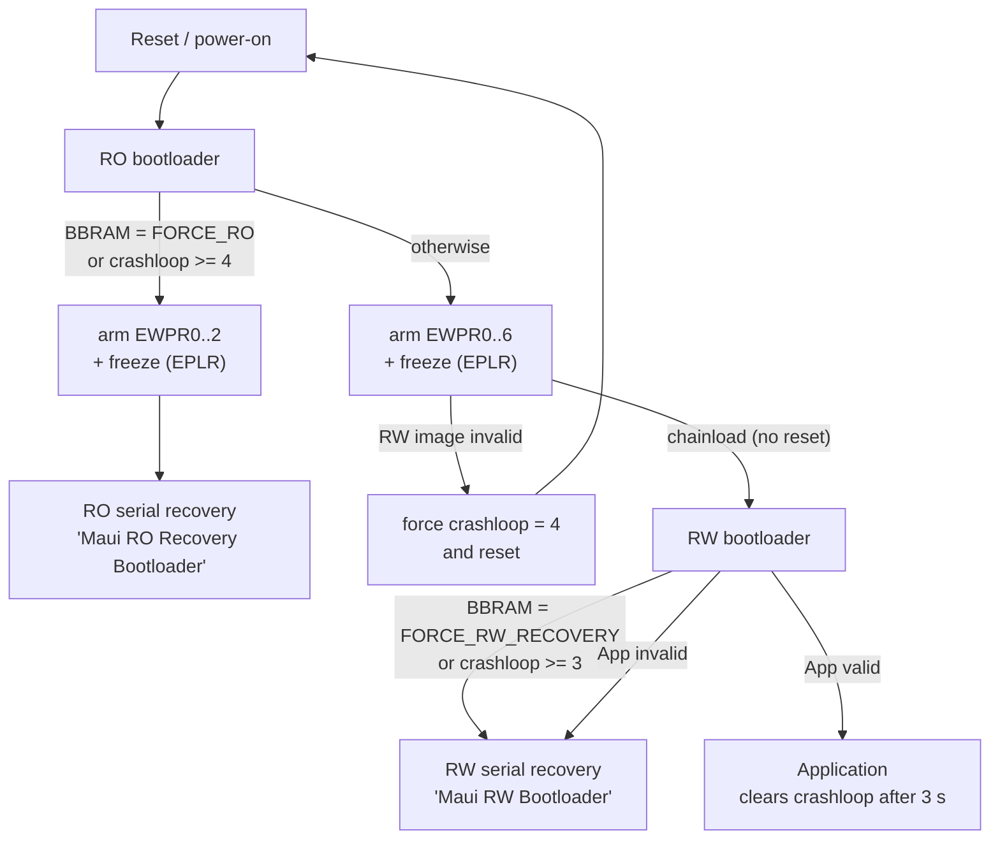

# Maui `maui_v1p2_it82002`

Board documentation for the ITE **IT82002AW** Maui prototype: flash layout, the
three-stage boot flow, hardware flash write-protection, and how to build and
flash the firmware.

*   **MCU**: ITE IT82002AW (RISC-V RV32IMC), 1 MB embedded flash, 256 KB SRAM
*   **Console**: Zephyr shell over native USB CDC ACM (`/dev/ttyACM*`)
*   **USB ID**: `18D1:5085` (all three stages share it; the product string tells
    them apart)
*   **Firmware update**: MCUboot serial recovery over SMP (`smpmgr`)

Unlike the TI targets, this board runs a **three-stage boot chain** (RO
bootloader -> RW bootloader -> App) with hardware write-protection of both
bootloaders.

---

## 1. Flash layout

Defined in [`maui_v1p2_it82002.dts`](maui_v1p2_it82002.dts). The MCU maps flash
at `0x80000000`; all offsets below are flash-relative.

| Offset | Size | Partition | Contents |
|---|---|---|---|
| `0x00000` | 96 KB | `ro_bootloader` | RO (root of trust) MCUboot. No image header, XIP at `0x80000000` |
| `0x18000` | 128 KB | `rw_bootloader` | RW MCUboot, integrity-checked, updatable in the field |
| `0x38000` | 768 KB | `image-0` | Main application, integrity-checked |
| `0xF8000` | 32 KB | `storage` | NVS key-value store (serial number, boot target) |

> [!IMPORTANT]
> There is **no secondary/staging slot**. Both bootloaders use
> `CONFIG_BOOT_DIRECT_XIP=y`, so images execute in place and there is no
> swap, no revert, and no "confirm" step. An interrupted upload leaves the
> target slot invalid until it is re-uploaded.

> [!WARNING]
> "Integrity-checked" is **not** "authenticated". Both bootloaders build with
> `CONFIG_BOOT_SIGNATURE_TYPE_NONE=y` + `CONFIG_BOOT_VALIDATE_SLOT0=y`, so
> MCUboot verifies an **unkeyed SHA-256** TLV: it detects a truncated or
> corrupted upload, but anyone can produce a passing image with a stock
> `imgtool sign` (no `-k`). The hardware write-protection below is what keeps
> the bootloaders intact; it is not a substitute for secure boot. See
> [§8 Threat model](#8-threat-model).

### Only slot 0 is writable over SMP

This trips people up constantly. `smpmgr --slot N` does **not** pick an MCUboot
slot — it sets the SMP *image number*, which MCUboot always resolves to the
**primary** slot of that image. We build with `CONFIG_UPDATEABLE_IMAGE_NUMBER=1`,
so image 0 is the only image that exists and **`--slot 0` is the only valid
value**. Any other value indexes past the end of MCUboot's internal slot table
and is rejected with `rc=3` before a single byte of flash is touched.

| Running stage | `--slot 0` writes | `--slot 1` |
|---|---|---|
| **RO** bootloader ([`ro_bootloader.overlay`](../../bootloader/mcuboot/ro_bootloader.overlay)) | RW bootloader (`0x18000`) | rejected, `rc=3` |
| **RW** bootloader (single-slot) | App (`0x38000`) | rejected, `rc=3` |

The RO bootloader redefines `slot0_partition`/`slot1_partition` via its overlay
so that its flash map covers the App region as well. `slot1_partition` is there
to satisfy MCUboot's direct-XIP slot table — RO deliberately never boots it
(`boot_find_next_slot_hook()` pins RO to slot 0), and serial recovery cannot
write it. **A broken App is therefore repaired in two steps**: reflash the RW
bootloader from RO, then reflash the App from RW.

---

## 2. Boot flow



The RO bootloader chainloads the RW bootloader **without an intervening reset**,
so register state set by RO persists into RW.

### Crashloop recovery (two-tier)

A counter in BBRAM (magic `'CRS\0'`, see
[`health.h`](../../src/health.h)) is incremented by the RO bootloader on every
boot and reset to 0 by the App once it has run for 2 seconds.

| Count | Behaviour |
|---|---|
| 1–2 | Normal boot |
| >= 3 | RW bootloader stops in serial recovery (reflash the App) |
| >= 4 | RO bootloader stops in serial recovery (reflash the RW bootloader) |

So a board that cannot keep its App alive falls back automatically, first to the
RW bootloader and then to the RO bootloader.

### Entering a bootloader deliberately

From the App shell:

```shell
reboot bootloader   # -> RW bootloader serial recovery (BBRAM 'RWBT')
reboot ro           # -> RO bootloader serial recovery (BBRAM 'ROBT')
reset               # -> normal boot
```

All of these perform an **ETWD hardware reset**; `sys_arch_reboot()` is
overridden in [`health.c`](../../src/health.c) so `kernel reboot cold` does the
same thing. There is no separate warm/cold distinction on this board — only
removing power is different.

---

## 3. Building

The it82002 build produces four artifacts and is **not** the default Docker
entrypoint flow used by the TI boards.

> [!WARNING]
> `CONFIG_FIND_NEXT_SLOT_HOOKS=y` in
> [`ro_bootloader.conf`](../../bootloader/mcuboot/ro_bootloader.conf) is
> load-bearing and fails **silently** if removed. It is a *different* Kconfig
> from `CONFIG_BOOT_IMAGE_ACCESS_HOOKS`; without it the call site expands to a
> no-op, the linker garbage-collects `boot_find_next_slot_hook()`, and the build
> still succeeds. The RO bootloader then falls through to slot 1 and XIP-boots
> the App whenever the RW bootloader is invalid — skipping the RW stage, so
> `EWPR3..6` and the EPLR freeze are never programmed and the App can rewrite
> the RW bootloader.

### One-time: builder image

```shell
docker build -t maui-builder-it82002 --build-arg BOARD=it82002 -f dockerfiles/Dockerfile.fw_builder .
```

> [!IMPORTANT]
> The image pins Zephyr to a **release tag** (`v4.4.2`) in
> [`Dockerfile.fw_builder`](../../../dockerfiles/Dockerfile.fw_builder), because
> `west` resolves the module revisions (MCUboot, mbedTLS, zcbor) from that
> tree's manifest. Tracking `main` made rebuilds non-reproducible and eventually
> broke the build outright: a later `main` force-enables
> `CONFIG_USBD_CDC_ACM_CLASS`, which compiles both the legacy and the
> device_next CDC-ACM drivers and fails the link with
> `multiple definition of __device_dts_ord_196`.
>
> Bump the tag deliberately, then rebuild and re-test the firmware — the
> bootloaders are sensitive to MCUboot API changes.

### Build everything

```shell
docker run --rm -v "$(pwd)":/repo -w /repo/firmware \
  --entrypoint bash maui-builder-it82002 \
  -c './bootloader/mcuboot/build_bootloaders.sh'
```

> [!IMPORTANT]
> `--entrypoint bash` is required. The image's default `ENTRYPOINT`
> (`/firmware_build.sh`) builds only the standalone single-image app and will
> **not** produce the bootloaders or the combined flash image.

[`build_bootloaders.sh`](../../bootloader/mcuboot/build_bootloaders.sh) uses
`west build -p always`, so every run is a clean build (~2–3 min). Outputs land in
`firmware/`:

| Artifact | Use |
|---|---|
| `maui_full_flash_1mb.bin` | Complete 1 MB image for an external programmer |
| `maui_rw_bootloader_signed.bin` | RW bootloader, for serial recovery from RO |
| `maui_app_signed.bin` | Application, for serial recovery from RO or RW |
| `maui_standalone_0x0.bin` | App linked at `0x0` with no bootloader; bringup isolation only |

### Verifying what you built

```shell
cd firmware
md5sum maui_full_flash_1mb.bin maui_app_signed.bin maui_rw_bootloader_signed.bin
strings -a -t x maui_full_flash_1mb.bin | grep '0\.60-'
```

The embedded version string (around offset `0x5A970`) is the reliable identity
check — compare it with `version` on the device after flashing. The **git hash in
it is captured at CMake configure time and can lag HEAD**, but the build
timestamp is always accurate.

### Disassembling

There is no RISC-V toolchain on the host, so use the container:

```shell
docker run --rm -v "$(pwd)":/repo -w /repo/firmware --entrypoint bash maui-builder-it82002 -c \
  '/usr/local/zephyr-sdk-1.0.1/gnu/riscv64-zephyr-elf/bin/riscv64-zephyr-elf-objdump -d build_mcuboot_ro/zephyr/zephyr.elf'
```

Build directories: `build_mcuboot_ro`, `build_mcuboot_rw`, `build_docker` (App),
`build_standalone`.

---

## 4. Flashing

`tools/scripts/maui-flash` does not support this board yet; use `smpmgr`
directly. Install it with `pip install smpmgr`, or use the `maui-utils`
container.

### Application (most common)

```shell
# From the App shell:
reboot bootloader
# Wait for "Maui RW Bootloader" to enumerate, then:
smpmgr --port /dev/ttyACM0 upgrade --slot 0 firmware/maui_app_signed.bin
```

### RW bootloader

```shell
# From the App shell:
reboot ro
# Wait for "Maui RO Recovery Bootloader", then:
smpmgr --port /dev/ttyACM0 upgrade --slot 0 firmware/maui_rw_bootloader_signed.bin
```

> [!IMPORTANT]
> RO recovery can rewrite the **RW bootloader only**; `--slot 1` does not reach
> the App and is rejected with `rc=3` (see
> [§1 Only slot 0 is writable over SMP](#only-slot-0-is-writable-over-smp)).
> To repair a board whose App is broken, flash the RW bootloader from RO as
> above, then reset. Because the RW bootloader is built with
> `CONFIG_BOOT_SERIAL_NO_APPLICATION=y`, it finds no bootable App and drops
> straight into "Maui RW Bootloader" serial recovery — flash the App from there
> with `--slot 0`.

### RO bootloader / full image

The RO bootloader is the root of trust and is hardware write-protected, so
**nothing running on the MCU can update it**. It requires an external programmer
writing `maui_full_flash_1mb.bin` at offset 0. This is also the recovery path for
a board with no working bootloader at all.

Confirm which stage is live before flashing:

```shell
dmesg | tail    # "Maui RO Recovery Bootloader" / "Maui RW Bootloader"
```

> [!NOTE]
> `smpmgr` prints `Error reading MCUMgr parameters ... rc=<MGMT_ERR.ENOTSUP: 8>`
> when it connects to a bootloader. This is expected and harmless — MCUboot's SMP
> server does not implement that command.

---

## 5. Flash write-protection

Both bootloaders are protected in **hardware**, by the SoC's GCTRL Eflash Write
Protect registers — not by software checks in the flash driver, which the
application could simply bypass. Implemented in
[`it82002_mcuboot_hook.c`](../../bootloader/mcuboot/it82002_mcuboot_hook.c).

### Registers

GCTRL base is `0x00F02000`. There is one register set per bus initiator path:

| Register | Offset | Blocks writes/erases from |
|---|---|---|
| `EWPRxPFH` | `0x60 + x` | Host (eSPI/LPC) |
| `EWPRxPFD` | `0xA0 + x` | Debugger (DBGR) |
| `EWPRxPFEC` | `0xC0 + x` | **EC CPU** — this core, including the SMFI path used by the Zephyr flash driver |
| `EPLR` | `0x37` bit 0 | Freezes all of the above |

> [!WARNING]
> **Measured geometry differs from the datasheet.** On this 1 MB part each EWPR
> bit covers one **4 KB** sector, i.e. **32 KB per register**, and the 16
> registers span the first 512 KB. The datasheet's register tables state 2 KB per
> bit / 256 KB total, which only holds for 256 KB parts. Measured on silicon by
> stepping the protected register count and observing where flash writes started
> failing. Using the datasheet numbers over-protects into the App slot and breaks
> serial recovery.

Protection blocks **writes and erases only** — reads and instruction fetch are
unaffected (read protection is the separate `ERPRxPFEC`), so XIP execution of the
bootloaders is fine.

### Policy

The RO bootloader is the only stage that cannot be reflashed over USB, so it
owns the policy and applies it before handing control anywhere:

| Stage | EWPR armed | EPLR |
|---|---|---|
| RO bootloader -> chainload RW | 0..6 -> `0x00000-0x37FFF` | **freeze** |
| RO bootloader -> serial recovery | 0..2 -> `0x00000-0x17FFF` | **freeze** |
| RW bootloader (all paths) | re-applies 0..6; already frozen, so a no-op | no-op |
| Application | inherits; programs nothing | — |

The App slot (`0x38000+`) and NVS are never protected on any path, so serial
recovery can always erase them.

`EPLR` is a **hard freeze**: once set, EWPR bits can be neither set nor
cleared. Freezing before the chainload is what closes the escalation path — a
replaced RW bootloader (images are only hash-checked, see
[§8 Threat model](#8-threat-model)) can no longer clear `EWPR0..2` and
overwrite the RO bootloader.

The RO *recovery* path deliberately arms only `EWPR0..2` before freezing, so RO
serial recovery can still reflash the RW bootloader at `0x18000`.

> [!NOTE]
> If the RW image is invalid, RO has already frozen at `EWPR0..6` by the time
> validation fails — so it cannot repair the very region that is broken. It
> detects this, forces the crashloop counter past the RO threshold and resets
> once; the next boot lands in RO recovery with `0x18000` writable. You will
> see one extra reboot before the recovery console appears.

> [!NOTE]
> The datasheet says `EPLR` is "cleared only by a power-on reset". On this part
> the **ETWD hardware reset clears it too** (measured), which is what makes
> freezing safe: every reset returns the chip to a programmable state, and the
> bootloaders reprogram EWPR from scratch. Reflashing a bootloader never requires
> a power cycle.

The EWPR registers live in the EC power domain and are cleared to `0x00` by any
reset, so every boot path reprograms them. `it82002_flash_protect_lock()` reads
the registers back and **only freezes if protection is confirmed armed** —
freezing an empty register file would leave flash unprotected *and*
unprotectable until the next reset.

---

## 6. What the Application must do

> [!IMPORTANT]
> The App **must** call `health_init()` during startup (it already does, from
> [`main.c`](../../src/main.c)). That schedules the work item which clears the
> BBRAM crashloop counter once the App has run for 3 s.
>
> An App that does not clear the counter looks perfectly healthy but leaves it
> incrementing on every boot, so the device drops into RW serial recovery on the
> third boot and RO serial recovery on the fourth — with no error message
> pointing at the cause. Anyone writing a new or cut-down payload for this board
> has to either call `health_init()` or clear
> `BBRAM[4..7]` themselves.

The App deliberately does **not** program the EWPR/EPLR registers. Protection
policy belongs to the bootloaders alone, so it cannot be influenced by
application code.

---

## 7. Diagnostics

```
health status              Show BBRAM state, EPLR, and the per-register EWPR table
health set_crashloop <n>   Force the BBRAM crashloop counter
health test_etwd_bbram     Verify BBRAM survives an ETWD hardware reset

# Only with CONFIG_MAUI_HEALTH_FLASH_DIAGNOSTICS=y (default y, dev builds):
health test_flash_protect  Actively attempt to erase/write bootloader sectors
health lock_eplr           Freeze the EWPR registers until the next reset
health probe_eplr          Determine whether EPLR sticks or freezes
```

> [!CAUTION]
> `health test_flash_protect` is a real attack: it erases and rewrites
> bootloader sectors to prove the hardware blocks it. It checks `EWPR0..6`
> first and aborts if protection is not armed, but that guard is only as good
> as our understanding of the silicon. Set
> `CONFIG_MAUI_HEALTH_FLASH_DIAGNOSTICS=n` for production images; `health
> status` reports the same state non-destructively.

Healthy `health status` on a normally booted App:

```
GCTRL_EPLR          : 0x01 (LOCKED)
EWPR0  0x00000-0x07FFF: 0xFF      0xFF      0xFF   RO Bootloader
...
EWPR6  0x30000-0x37FFF: 0xFF      0xFF      0xFF   RW Bootloader
EWPR7  0x38000-0x3FFFF: 0x00      0x00      0x00   App slot (must be 0x00)
```

`EWPR7` **must** read `0x00`. If it is set, MCUboot serial recovery cannot erase
the App slot and `smpmgr upgrade` fails immediately with `rc=3`
(`MGMT_ERR_EINVAL`), because `bs_upload()` erases the whole slot on the first
chunk.

> [!CAUTION]
> `health test_flash_protect` is a **real attack** — it erases and writes
> bootloader sectors to prove they are protected. It aborts before doing so if
> the EWPR registers are not fully armed, but never remove that guard: running
> the attack unprotected destroys both bootloaders and the board then needs an
> external programmer.

A blocked operation surfaces as **`-EINVAL (-22)`**, not `-EACCES`: the hardware
drops the transaction silently and the upstream ITE driver only notices via its
read-back verification. Since that verification just checks for `0xFF`, an erase
of an already-blank sector returns `0` whether or not it was blocked — protection
tests must be blank-aware.

---

## 8. Threat model

What this design actually buys, and what it does not:

| Threat | Covered? |
|---|---|
| Corrupted / truncated image accepted and booted | **Yes** — MCUboot rejects it on the SHA-256 TLV and falls back to serial recovery |
| Buggy application bricking the board | **Yes** — hardware write-protection + the crashloop counter |
| Accidental erase of a bootloader by application code or a stray flash command | **Yes** — EWPR blocks it at the bus |
| Someone with USB access overwriting the **RO bootloader** | **Yes** — RO freezes `EWPR0..2` before any other code runs |
| Someone with USB access flashing their own **RW bootloader or App** | **No** |
| Someone with an external SPI programmer | **No** |

The gap is deliberate for a bring-up board. With
`CONFIG_BOOT_SIGNATURE_TYPE_NONE=y` the image TLV is an unkeyed SHA-256, and
MCUboot serial recovery erases and writes the target slot *before* it validates
anything (the TLV sits at the end of the image). So an attacker who can reach
serial recovery can upload any image that `imgtool sign` produces, and it will
boot.

Closing that gap needs real signatures
(`CONFIG_BOOT_SIGNATURE_TYPE_ECDSA_P256` plus key management and a signing
step in the build), which is out of scope here. Until then, treat physical USB
access to the board as equivalent to full firmware control, and rely on the
write-protection only to stop *accidents*, not attacks.

---

## 9. Gotchas

*   **Slot numbers differ between bootloaders.** See the table in section 1.
*   **The RO bootloader must never boot the App directly.** Slot 1 exists only so
    RO serial recovery can reflash the App. MCUboot's default direct-XIP
    selection would fall through to it when the RW bootloader is invalid, which
    skips the RW stage entirely — leaving `EWPR3..6` and the EPLR freeze
    unprogrammed, so the App could rewrite the RW bootloader. The slot hook
    pins selection to slot 0.
*   **Image versions are all `1.0.0`.** Direct-XIP otherwise picks the slot with
    the highest version; ties keep the first candidate. Do not rely on this —
    the slot hook now makes it moot for RO.
*   **Do not use GPJ6 (`EC_BSL_INVOKE`)** for recovery entry on this board. The
    App only exposes it as a plain input (`gpio get ec_bsl_invoke`); the
    bootloaders ignore it (`CONFIG_BOOT_SERIAL_ENTRANCE_GPIO=n`).
*   **A version-string mismatch after flashing always means the bytes never
    reached the chip.** The 1 MB image contains exactly one version string and
    there is no secondary slot to hide a stale copy in.

---

## 10. Key files

| Path | Purpose |
|---|---|
| [`maui_v1p2_it82002.dts`](maui_v1p2_it82002.dts) | Board DTS, partition table |
| [`it82002_mcuboot_hook.c`](../../bootloader/mcuboot/it82002_mcuboot_hook.c) | Boot target selection, crashloop logic, flash protection, slot hook, USB descriptor |
| [`build_bootloaders.sh`](../../bootloader/mcuboot/build_bootloaders.sh) | Builds all stages and assembles the 1 MB image |
| [`ro_bootloader.conf`](../../bootloader/mcuboot/ro_bootloader.conf) / [`.overlay`](../../bootloader/mcuboot/ro_bootloader.overlay) | RO bootloader config and slot remap |
| [`rw_bootloader.conf`](../../bootloader/mcuboot/rw_bootloader.conf) / [`.overlay`](../../bootloader/mcuboot/rw_bootloader.overlay) | RW bootloader config |
| [`health.c`](../../src/health.c) / [`health.h`](../../src/health.h) | ETWD reset, BBRAM crashloop, `health` shell commands |
